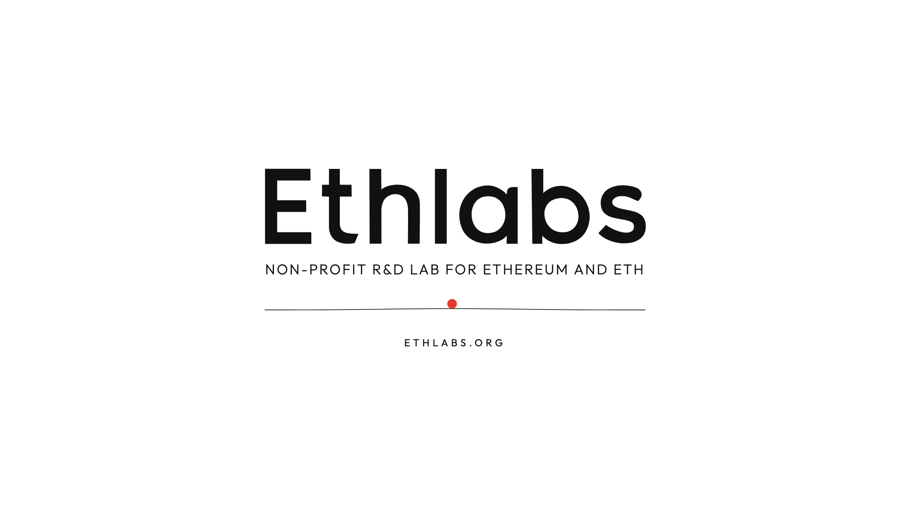

# ethlabs-reel

A 15-second motion piece for [Ethlabs](https://ethlabs.org): 1080p60 with its own soundtrack, all generated in code.
One hairline runs through the whole film and everything settles on it. `STORYBOARD.md` has the beat sheet.

[](media/ethlabs.mp4)

▶ [media/ethlabs.mp4](media/ethlabs.mp4)

## Build

You need Node 18+, a Chromium headless shell, and ffmpeg with libx264. No npm install.

```sh
npx playwright install chromium                 # installs the headless shell
mkdir -p bin && ln -s "$(command -v ffmpeg)" bin/ffmpeg
CHROME=~/Library/Caches/ms-playwright/chromium_headless_shell-<build>/chrome-headless-shell-mac-arm64/chrome-headless-shell \
  ./render-all.sh
```

This writes `out/ethlabs.mp4` (master), `out/ethlabs-web.mp4` and `out/poster.png`. On a 16-core Mac it takes about 15 s.
If you leave out `CHROME`, `render.mjs` falls back to Playwright build 1243 on macOS arm64.

To preview, open `index.html` in a browser. It plays live, and `index.html?t=6.2` shows a single frame.

## How it works

- `main.js` draws the whole film on one canvas, and `window.seek(t)` draws time `t`. It covers the string physics (every landing plucks the line), the 3D diamond and globe, the camera, and motion blur (12–24 sub-frames).
- `synth.mjs` makes the soundtrack procedurally: 128 BPM, with Karplus-Strong strings for every landing. Its event times come from the page (`window.SYNC` → `out/sync.json`), so 512 raindrops and 18 letters land on the exact frame.
- `render.mjs` drives headless Chrome over the DevTools protocol and pipes the frames into ffmpeg, which converts them to BT.709.
- `brand.js` holds the Ethlabs wordmark and homepage drawing, extracted from ethlabs.org.
- QA stills: `sheet.sh`, `sheet16.sh`, `strip.sh`, `strip12.sh`, `qa.sh`.

The font is Outfit, under the SIL Open Font License 1.1 (see `fonts/OFL.txt`).
